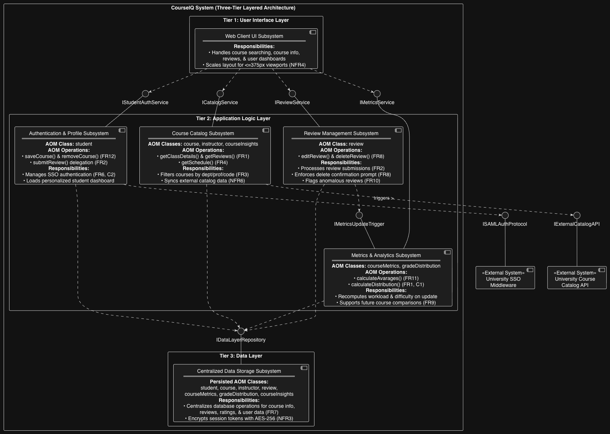

# CourseIQ

## Team Name
Best Team in SWE

## Team Members
- Renold Thomas (Developer)
- Caleb Teeters (Developer)
- Drew Rosinsky (Product Owner)
- Natalie Goldsworthy (Scrum Master)
- Eric Lutz (Developer)

## Project Purpose
CourseIQ will be a crowdsourced hub that provides a centralized location for students to view course insights, including workload,
difficulty, grading, assignments, exams, etc.

## Project Plan
We plan to build the system as a web application using a standard stack consisting of React for the frontend, Node.js with Express for our backend middleware, and PostgreSQL (or a similar relational database) to securely store course and review data. Currently, the one thing we are unsure about is how exactly we will integrate the university's existing SAML Single Sign-On (SSO) system for authentication and how to gain access to the external course catalog API to pull official prerequisite and scheduling data. 

# Techstack
| Layer | Technology |
| :---: | :---: |
| Languages | HTML/CSS, JavaScript, Python, SQL |
| Frontend | React (JavaScript, HTML/CSS) |
| Backend | Flask (Python) |
| Database | PostgreSQL |

### Generative AI Usage
ChatGPT was used to generate the initial React frontend for the CourseIQ application, including the course discovery homepage, sample course data, styling, and configuration files. It was also used to assist with debugging and resolving a React import error. The generated code was tested locally before being committed to the repository.

## Our Architecture



# Frontend (React + Vite)

## Prerequisites
- Node.js 18 or newer (Node 20 LTS recommended)
- npm

## Run locally
```bash
cd frontend
npm install
npm run dev
```
Open the local URL shown in the terminal (normally http://localhost:5173).

**Data source:** if `frontend/.env` defines `VITE_SUPABASE_URL` and `VITE_SUPABASE_KEY`, courses load from the Supabase `courses` table. If those variables are missing, the app falls back to the sample courses in `src/data.js` and shows a "Sample data" tag.

## Course search (US5)
Students can narrow the course list with three filters:
- **Department**: dropdown of every department in the catalog
- **Professor**: text, partial match (e.g. `smith` matches "Dr. Smith")
- **Course code**: text, partial match; spaces are optional (e.g. `cs1501` matches "CS 1501")

Filters can be used alone or together. When several filters are set, a course must match **all** of them. Text matching ignores case and leading/trailing spaces. Results update as you type. **Clear filters** (or clicking the CourseIQ logo) resets everything. Each result shows the course code, title, professor, and average difficulty, or "Not enough data" when the course has no reviews. If nothing matches, the page shows "No courses found".

Code layout:
- `src/courseSearch.js`: pure filtering and formatting functions (no React), unit-tested
- `src/courseService.js`: loads courses (Supabase, or sample data as a fallback)
- `src/App.jsx`: page UI (filters, results, course details dialog)

## Automated tests
```bash
cd frontend
npm test          # run once (Vitest)
npm run test:watch  # re-run on file changes
npm run build     # verify the production build
```

## Save a course (US3)

Students can save courses they are considering and view them in a **Saved Courses** section at the top of the page.

**How to save a course:**
- Click the **Save** button on any course card in the Explore Courses grid, or open a course's details dialog and click **Save** next to the title.
- The button changes to **Saved ✓** to confirm the course has been saved.

**How to view saved courses:**
- Saved courses appear in the **Saved Courses** section above the Explore Courses grid.
- If no courses are saved, an empty-state message is shown.

**How to remove a saved course:**
- Click the **Saved ✓** button on a course card (in the Saved Courses section or the main grid) or in the course details dialog.
- The button returns to **Save** and the course is removed from the Saved Courses section.

**Persistence:** Saved courses are stored in browser `localStorage` and persist across page reloads. Full persistence across logout/login (AC7) requires user authentication (US1), which has not yet been implemented.

**Database migration:** No migration is required for the localStorage implementation. When authentication is added, apply the following SQL to your Supabase project to enable per-user persistence:

```sql
CREATE TABLE IF NOT EXISTS public.saved_courses (
    id BIGINT GENERATED BY DEFAULT AS IDENTITY PRIMARY KEY,
    user_id UUID NOT NULL,
    course_id BIGINT NOT NULL REFERENCES public.courses(id) ON DELETE CASCADE,
    saved_at TIMESTAMPTZ NOT NULL DEFAULT NOW(),
    UNIQUE (user_id, course_id)
);

ALTER TABLE public.saved_courses ENABLE ROW LEVEL SECURITY;

CREATE POLICY "Users can read their own saved courses"
    ON public.saved_courses FOR SELECT
    USING (auth.uid() = user_id);

CREATE POLICY "Users can insert their own saved courses"
    ON public.saved_courses FOR INSERT
    WITH CHECK (auth.uid() = user_id);

CREATE POLICY "Users can delete their own saved courses"
    ON public.saved_courses FOR DELETE
    USING (auth.uid() = user_id);
```

## Not yet implemented / limitations
- Filtering runs in the browser over the full course list. No backend search API exists yet (`backend/` and `database/schema.sql` are still empty).
- The search performance target (NFR5: under 500 ms with 5,000 concurrent users) has not been load-tested.
- Authentication/SSO, review submission, and official catalog data are not implemented.
- Saved course persistence across logout/login (US3 AC7) requires authentication (US1) to be completed first.
- Sample data is fictional demonstration content.
