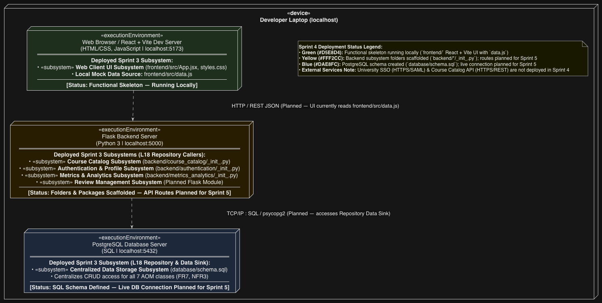

# CourseIQ

## Team Name
Best Team in SWE

## Team Members
- Renold Thomas (Developer)
- Caleb Teeters (Developer)
- Drew Rosinsky (Product Owner)
- Natalie Goldsworthy (Scrum Master)
- Eric Lutz (Developer)

## Project Purpose
CourseIQ will be a crowdsourced hub that provides a centralized location for students to view course insights, including workload,
difficulty, grading, assignments, exams, etc.

## Project Plan
We plan to build the system as a web application using a standard stack consisting of React for the frontend, Node.js with Express for our backend middleware, and PostgreSQL (or a similar relational database) to securely store course and review data. Currently, the one thing we are unsure about is how exactly we will integrate the university's existing SAML Single Sign-On (SSO) system for authentication and how to gain access to the external course catalog API to pull official prerequisite and scheduling data. 

# Techstack
| Layer | Technology |
| :---: | :---: |
| Languages | HTML/CSS, JavaScript, Python, SQL |
| Frontend | React (JavaScript, HTML/CSS) |
| Backend | Flask (Python) |
| Database | PostgreSQL |

### Generative AI Usage
ChatGPT was used to generate the initial React frontend for the CourseIQ application, including the course discovery homepage, sample course data, styling, and configuration files. It was also used to assist with debugging and resolving a React import error. The generated code was tested locally before being committed to the repository.

## Our Architecture



# Frontend (React + Vite)

## Prerequisites
- Node.js 18 or newer (Node 20 LTS recommended)
- npm

## Run locally
```bash
cd frontend
npm install
npm run dev
```
Open the local URL shown in the terminal (normally http://localhost:5173).

**Data source & environment variables (`frontend/.env`):** 
- `VITE_SUPABASE_URL`: Base Supabase project URL (without `/rest/v1`).
- `VITE_SUPABASE_KEY`: Supabase public `anon` key.
- `VITE_API_URL` *(optional)*: Base URL for the Flask backend used by Course Details (defaults to `http://localhost:5001`).

If `VITE_SUPABASE_URL` and `VITE_SUPABASE_KEY` are defined in `frontend/.env`, courses load from the Supabase `courses` table; otherwise, the app falls back to the sample courses in `src/data.js` and shows a "Sample data" tag.

## Course search (US5)
Students can narrow the course list with three filters:
- **Department**: dropdown of every department in the catalog
- **Professor**: text, partial match (e.g. `smith` matches "Dr. Smith")
- **Course code**: text, partial match; spaces are optional (e.g. `cs1501` matches "CS 1501")

Filters can be used alone or together. When several filters are set, a course must match **all** of them. Text matching ignores case and leading/trailing spaces. Results update as you type. **Clear filters** (or clicking the CourseIQ logo) resets everything. Each result shows the course code, title, professor, and average difficulty, or "Not enough data" when the course has no reviews. If nothing matches, the page shows "No courses found".

Code layout:
- `src/courseSearch.js`: pure filtering and formatting functions (no React), unit-tested
- `src/courseService.js`: loads courses (Supabase, or sample data as a fallback)
- `src/App.jsx`: page UI (filters, results, course details dialog)

## View course details (US6)
Students can inspect detailed information and anonymous written reviews for any course in the catalog.

**What it does:**
- Fetches live course details and reviews from the Flask backend (`GET /api/courses/<id>`) backed by Supabase PostgreSQL.
- Displays the course code, title, professor, department, course description, scheduled meeting times, average difficulty, weekly workload, and total review count.
- Lists written student reviews sorted **newest first** while stripping all reviewer names and identifying fields (FERPA / C1).
- Displays `"No reviews yet"` with a `"Write a review"` link when a course has zero written reviews.
- Scales cleanly down to a `375px` mobile viewport width with no horizontal scrolling (NFR4).

**How to use it:**
1. Start both the Flask backend (`http://localhost:5001`) and the React frontend (`http://localhost: 5173`).
2. Click **View course details** on any course card (for example, **CS 1501** to view populated reviews sorted newest first, or **PSY 0010** to view the `"No reviews yet"` empty state).
3. Close the dialog by clicking `x`, clicking outside the modal, or pressing `Esc`.

Code layout:
- `frontend/src/components/CourseDetailsModal.jsx`: course details modal UI and Flask API fetch
- `backend/course_catalog/routes.py`: `GET /api/courses/<course_id>` endpoint
- `backend/course_catalog/service.py`: PostgreSQL queries, newest-first review sorting, and reviewer field sanitization
- `database/schema.sql`: PostgreSQL schema for `courses` and `course_reviews`

## Automated tests
```bash
cd frontend
npm test          # run once (Vitest)
npm run test:watch  # re-run on file changes
npm run build     # verify the production build
```

# Backend (Flask + PostgreSQL)

## Prerequisites
- Python 3.10 or newer
- `pip`

## Environment variables
Copy `backend/.env.example` to `backend/.env` and set:
- `DATABASE_URL`: Supabase Session Pooler PostgreSQL connection URI (URL-encode special characters in the password, e.g. `%` → `%25`, `!` → `%21`).
- `PORT` *(optional)*: Port for the Flask server (defaults to `5001` to avoid macOS AirPlay conflicts on port `5000`).

## Run locally
```bash
cd backend
python3 -m venv venv
source venv/bin/activate      # Windows: venv\Scripts\activate
pip install -r requirements.txt
python app.py

## Not yet implemented / limitations
- Course search filtering runs in the browser over the full course list. No backend search API exists yet (the Flask backend in `backend/` and PostgreSQL schema in `database/schema.sql` currently serve course details and reviews via `GET /api/courses/<id>`).
- The search performance target (NFR5: under 500 ms with 5,000 concurrent users) has not been load-tested.
- Authentication/SSO, review submission, and official catalog data are not implemented.
- Sample data is fictional demonstration content.
