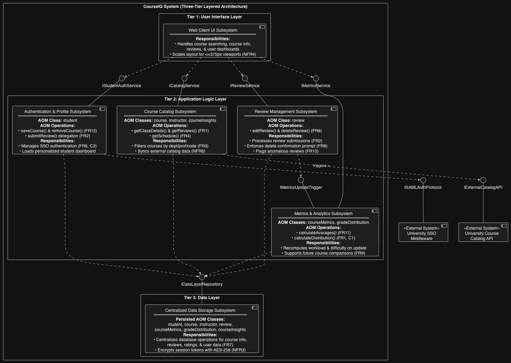
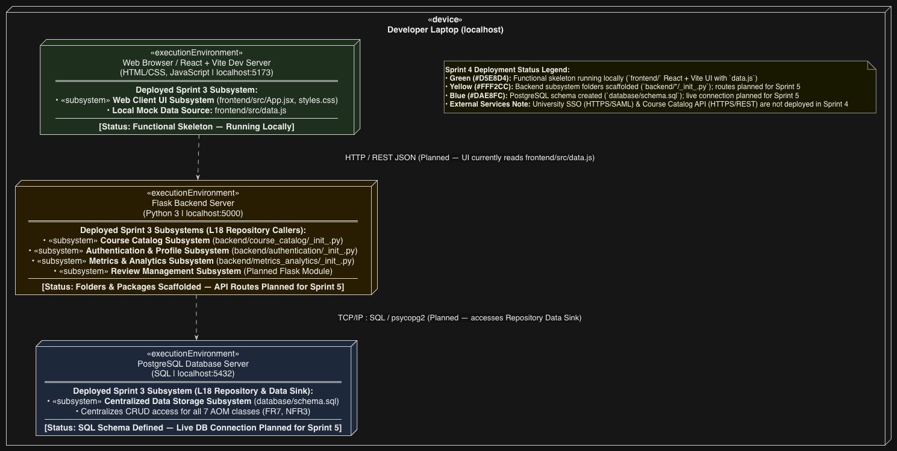

# CourseIQ

## Team Name
Best Team in SWE

## Team Members
- Renold Thomas (Developer)
- Caleb Teeters (Developer)
- Drew Rosinsky (Product Owner)
- Natalie Goldsworthy (Scrum Master)
- Eric Lutz (Developer)

## Project Purpose
CourseIQ will be a crowdsourced hub that provides a centralized location for students to view course insights, including workload,
difficulty, grading, assignments, exams, etc.

## Project Plan
We plan to build the system as a web application using a standard stack consisting of React for the frontend, Node.js with Express for our backend middleware, and PostgreSQL (or a similar relational database) to securely store course and review data. Currently, the one thing we are unsure about is how exactly we will integrate the university's existing SAML Single Sign-On (SSO) system for authentication and how to gain access to the external course catalog API to pull official prerequisite and scheduling data. 

### Generative AI Usage
ChatGPT was used to generate the initial React frontend for the CourseIQ application, including the course discovery homepage, sample course data, styling, and configuration files. It was also used to assist with debugging and resolving a React import error. The generated code was tested locally before being committed to the repository.

## Our Architecture



# CourseIQ — Sprint 4 React demo

Standalone React/Vite course-discovery homepage, intended to be integrated into the team's three-tier project skeleton.

## Prerequisites
- Node.js 18 or newer (Node 20 LTS recommended)
- npm

## Run locally
```bash
cd frontend
npm install
npm run dev
```
Open the local URL shown in the terminal (normally http://localhost:5173).

## Check that it works
1. Search for `CS 1501` or `Smith` and verify matching results.
2. Select `Economics` in the department filter and verify only economics courses appear.
3. Click **View course details** to open the details dialog.
4. Search for `xyz-not-a-course` and verify the empty-state message.
5. Run `npm run build` to verify the production bundle builds.

## Integration
- `src/App.jsx` — homepage component (presentation subsystem)
- `src/styles.css` — styling
- `src/data.js` — illustrative mock data; replace with backend API responses in a later sprint
- `src/main.jsx` — Vite entry point; teammate can use `<App />` in their existing React application instead

## Works now
- React application starts
- Search by code, title, professor
- Department filtering
- Course details dialog
- Responsive layout and empty state

## Not implemented
- Authentication / SSO
- Review submission, storage, editing
- Backend, database, live catalog data, real grade distributions
- Actual university course or instructor information

All displayed data is fictional demonstration content. This is not a production application.
